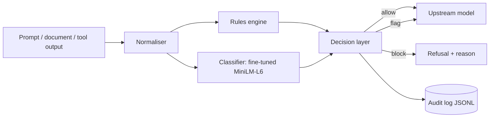

# Sentinel: spec

A guard that screens prompts and retrieved content for injection and jailbreak attempts before they reach a model. Python, HF Transformers, FastAPI. Port 8108. Repo `Sentinel`, MIT, Aditya Jain.

## Architecture

## Module layout (`src/sentinel/`)

- `normalize.py`: NFKC, zero-width/bidi stripping, homoglyph folding (confusables table), leetspeak and spaced-letter folding, base64/hex/ROT13 candidate decoding. Returns normalised text plus an offset map and a list of transformations applied (so spans can be highlighted on the original text and "obfuscation used" is itself a signal).
- `rules.py` + `rules_data/*.yaml`: rule = id, category, severity (low/med/high), regex or token predicate, description, examples, applies_to (`user` / `document` / both). ~40 rules across the families in RESEARCH.md. Each rule has positive and negative test strings; tests iterate every rule.
- `classifier.py`: loads the fine-tuned model (path from env or `models/`), batch inference, returns P(injection); `baseline.py` TF-IDF + LR.
- `decision.py`: combines rule hits and score into `allow | flag | block` plus a human-readable reason. Policy: block if score >= T_block, or high-severity rule and score >= T_agree; flag if score >= T_flag or any rule; otherwise allow. Thresholds are chosen on the validation set (T_block at a target FPR on hard-benign + realistic benign, e.g. 1%; T_flag for recall) and stored in `thresholds.json`, never tuned on test. Probability calibration (Platt/temperature) fitted on validation, reliability curve reported.
- `screen.py`: `Sentinel.screen(text, source="user"|"document"|"tool")`, returns a typed `Decision` (action, score, rules hit with spans on original text, normalisation notes, reason, latency). Documents/tool outputs use a stricter policy (any imperative-to-assistant pattern flags).
- `audit.py`: append-only JSONL, one record per decision (timestamp, id, action, score, rule ids, source, text hash and truncated text; full text off by default for privacy), reader with filters.
- `server/app.py` (FastAPI): `GET /health`, `POST /v1/screen`, `POST /v1/screen/batch`, `POST /v1/screen/document`, `GET /v1/audit`, `GET /v1/metrics` (recorded eval artefacts), `GET /v1/rules`, and the proxy `POST /v1/chat/completions` (OpenAI-compatible: screens the user/tool messages, on block returns an OpenAI-shaped refusal with `finish_reason: "content_filter"`, on allow/flag forwards to `UPSTREAM_BASE_URL` with the caller's key, streaming passthrough, adds `X-Sentinel-Decision` header). Upstream tested with a stubbed `httpx` transport; no real upstream exercised and README says so. Also serves the web UI.
- `cli.py`: `sentinel screen "text"`, `sentinel serve`, `sentinel eval`, `sentinel train`, `sentinel fetch-model`.
- `data/`: `build_dataset.py` (download, license-check, dedupe, split), `hand_written/*.jsonl` (my own sets, committed, small).
- `train.py`: HF Transformers fine-tune (plain Trainer or PyTorch loop), CPU, seeded, logs to `runs/`. `eval.py`: all metrics below to `docs/data/eval.json` and PNGs. `export_demo.py`: builds the recorded stream.

Weights are not committed: `sentinel fetch-model` downloads if I host a release asset later, otherwise `sentinel train` (minutes on CPU) reproduces them. Model card in `MODEL_CARD.md`.

## Data and evaluation plan

- Train: neuralchemy `core` train + jackhhao + hand-written train half (hard benign, obfuscated). Validation: neuralchemy validation + hand-written val. Dedup on normalised text across all splits first; report counts.
- Test sets (never touched during training or threshold choice): (1) in-distribution neuralchemy test; (2) **OOD**: deepset/prompt-injections (all 662, EN/DE reported separately); (3) SPML user prompts (subsample); (4) hand-written **hard-benign test** (talks about injection) and **obfuscated attack test**; (5) realistic benign: dolly-15k sample (FPR only); (6) indirect set (documents/tool outputs, synthetic, small).
- Systems compared on identical sets: rules only, TF-IDF+LR, fine-tuned MiniLM-L6, full Sentinel (ProtectAI v2 zero-shot was planned and not run) (rules + classifier + decision).
- Metrics: precision, recall, F1, ROC-AUC, PR-AUC, ROC and PR curves, confusion matrix at the chosen thresholds, FPR on hard-benign and realistic benign with Wilson intervals (sets are small; I will show the intervals), calibration curve, per-category recall, p50/p95 latency per prompt on this CPU (single and batch, rules vs classifier vs total). Shortcut checks: length-only baseline, label-shuffle sanity check.
- Negative results stay in the README (e.g. German OOD recall, obfuscation the rules miss).

## UI (served locally; static copy in `docs/`)

Single page, dark, design tokens from the portfolio (void `#07080a`, lime `#d7ff3f`, orange `#ff7a3d`, Inter Tight / Instrument Serif italic / JetBrains Mono). Phone first.

1. **Hero stream (the scene, for real).** Canvas: prompts drift left to right toward a model node; a shield arc sits in front of it. Allow = lime packet passes through; flag = lime-to-orange packet passes with a marker; block = orange packet bounces off the shield with a shockwave. Each packet is a real decision. Static demo: replays the recorded evaluation stream (a few hundred test items, real scores, real rule hits, labelled "recorded run"), with a running counter of blocked/flagged/allowed and the true label shown so misses and false positives are visible, not hidden. Local mode: same canvas, but the visitor's typed prompt becomes a packet whose fate comes from `/v1/screen`.
2. **Inspector (local mode; static mode shows pre-recorded examples to click).** Text field (16 px font, no iOS zoom). On submit: highlighted spans on the original text, rule chips with id/category/severity, classifier score gauge with the thresholds drawn, normalisation notes ("zero-width removed, base64 decoded"), the decision and reason. Toggle "document / tool output" source. Example chips for attack, obfuscated, hard-benign.
3. **Metrics.** Real ROC and PR curves (SVG drawn from `eval.json`), confusion matrix, threshold slider showing the confusion matrix and FPR moving (computed from stored scores), per-dataset table, latency table, comparison with baselines.
4. **Audit log.** Table of decisions (filter by action/rule); local mode reads `/v1/audit`, static mode shows the recorded stream's log. Row expands to the full decision.
5. Footer: "Built by Aditya Jain" and repo link. Reduced-motion: packets appear in final positions with no travel. Canvas DPR capped at 2, paused off screen.

Vanilla JS modules, GSAP only if it earns it; no build step. Playwright script at 1440x900 and 390x844 touch with console-error capture; screenshots to `docs/assets/`.

## Tests

Fast, offline: normaliser cases (each obfuscation type), every rule's positive/negative strings, decision-layer table tests, audit log round-trip, FastAPI endpoints via `TestClient` with a stub classifier, proxy with stubbed upstream (allow forwards, block refuses, streaming), threshold/metrics code on toy data, dataset dedupe/split leakage test. Marked `slow`: train a tiny model for a few steps, real-model sanity on a handful of prompts. GitHub Actions: ruff + fast tests.

## Done means

- Pipeline reproducible from a clean clone: build data, train, eval, export demo, serve; commands in README.
- All reported numbers come from `sentinel eval` on the machine I train on and match `docs/data/eval.json`.
- Hard-benign FPR and the OOD results reported honestly with intervals; limitations section covers multilingual, adaptive attackers, no-guarantee nature, over-defense.
- Tests and ruff pass; UI screenshot-checked at both sizes, no console errors; static `docs/` works from a plain file server; clean history under Aditya's identity; no AI mentions anywhere.

## Risks

- Hand-written eval sets are mine and small; intervals will be wide. Mitigation: state it, keep them in the repo.
- neuralchemy is partly synthetic; in-distribution scores will look inflated. OOD and hard-benign are the headline, not the in-distribution F1.
- Transformers 5.x API drift; fallback to a plain PyTorch loop.
- Training data licence mix (Apache/MIT for what I use; dolly is CC-BY-SA, used only for eval via download).
- A public "attack bounces" demo may invite adaptive bypass attempts; fine, but the README will not claim robustness.
